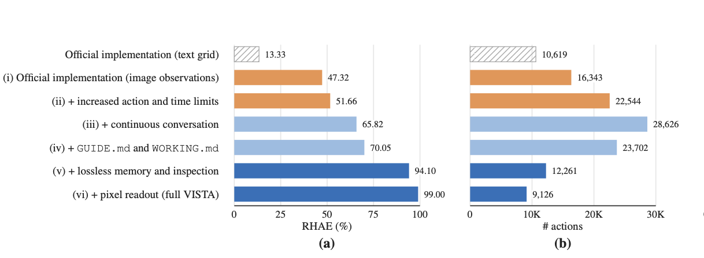
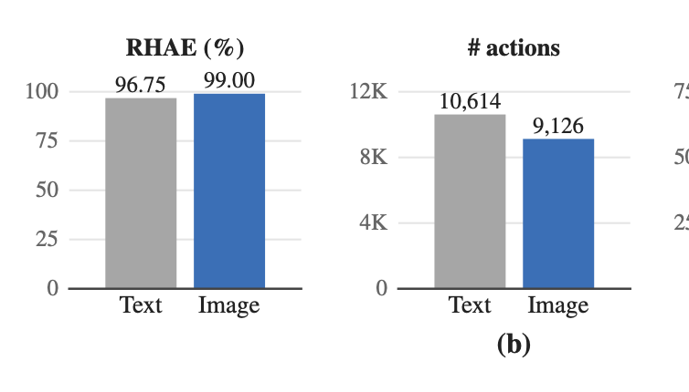
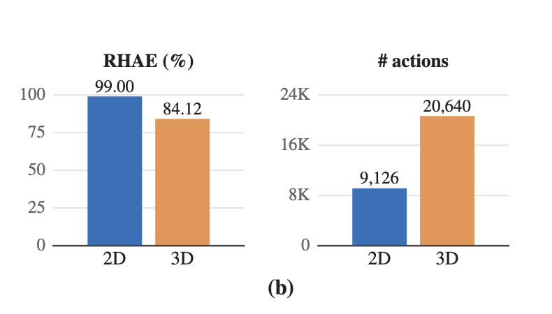

# 生成统计图的默认样式

本节依据用户于 2026-10-25 提供并指定的三张 VISTA 论文图截图。制作或重绘统计图前先阅读本节并打开相应例图。截图用于学习样式，其中的数值不能移用为其他任务的实验结果。截图中的裁切边界也不能照搬到新图中。

## 页面配色与图内配色

PPT 页面仍使用白底、蓝色标题与横线、黑色正文。统计图内部单独采用本节配色，不受页面蓝黑两色限制；不要把所有柱子强行改成页面标题的亮蓝色或黑色。

从用户截图的纯色区域读取的颜色如下：

| 用途 | 颜色 | 使用方式 |
| --- | --- | --- |
| 方法或主要配置 | 蓝色 `#3B6FB6` | 主要方法、图像输入、2D 条件等 |
| 基线或参考方法 | 中灰 `#A6A6A6` | 普通基线、文本输入等 |
| 第二比较条件或前期配置 | 橙色 `#E0975A` | 例如 3D 条件，或消融中的前期配置 |
| 中间配置 | 浅蓝 `#9EBCE0` | 消融中的中间阶段 |
| 网格线 | 浅灰 `#E5E5E5` | 轻、细、位于柱形后方 |
| 坐标基线 | 深灰 `#444444` | 细实线，不使用粗黑外框 |
| 指标名、类别名和数值 | 近黑 `#222222` | 高对比、直接可读 |
| 数值轴刻度 | 灰色 `#666666` | 比数据标签稍弱 |
| 图背景 | 白色 `#FFFFFF` | 不加有色面板底或渐变 |

按比较含义选用两到三种数据色，不为凑齐配色使用全部颜色。相同方法或条件在整套汇报中保持同一颜色；颜色不代表结果好坏，不因某个值更大就临时换色。外部报告基线需要单独区分时，可用白底、灰边与稀疏灰色斜线填充，配上明确标签。

## 柱形与布局

- 使用平面矩形柱，不用圆角、渐变、阴影、立体效果或彩色背景框。柱宽一致，柱间留出清楚间隔。
- 条件名称较长或需要顺序展示累加配置时，用横向条形图；两三个短类别比较时，用竖向柱形图。不要为了保持竖向形式缩小长标签。
- 同一组实验的不同指标采用紧凑的并排小图。子图等高对齐，横向条形图的类别行也要逐行对齐；相同类别顺序、颜色和柱宽保持一致。
- 每个指标独立标明名称与单位，不能把 RHAE、动作数、token 等不同量纲塞进同一个数值轴。不同指标允许不同范围；同一指标跨子图直接比较时，使用一致范围和刻度。
- 一个页面只保留服务于当前结论的必要子图。只有确需指代时才使用 `(a)`、`(b)` 等图内 panel 编号，不把它们当作 PPT 页脚或页码。

## 坐标轴、网格与标注

- 柱形图的数值轴通常从 0 开始，负值保留完整范围。不能为夸大差异截断坐标轴；确需特殊范围时须明确标注。
- 保留清楚的底部或数值基线，弱化或去掉上、右和不必要的侧边框。竖向柱形图使用浅灰水平网格；横向条形图使用浅灰竖直网格。
- 网格只保留少量主要刻度，不加密集次网格。刻度与柱末数值不互相遮挡。
- 数值直接写在柱顶或条形末端外侧，使用近黑文字并留出空隙。优先靠类别名和直接标注解释比较，不额外堆图例。
- 分数按源数据保留合理的小数位；动作等整数计数使用千位逗号。坐标刻度可以用 `4K`、`8K`、`12K` 等简写，单位和含义必须明确。不得为统一外观改变数据精度或数值含义。

## 图内字体

图内英文和数字使用与例图接近的论文式衬线体，默认 `Times New Roman`。指标名加粗，类别名、刻度和数值用常规字重。需要中文标签时使用圆体-简（`Yuanti SC`）并按实际视觉大小调整。页面标题和正文仍按 `Yuanti SC` 与 `Comic Sans MS` 的既定搭配，不把 `Comic Sans MS` 强加到本节统计图的英文和数字上。

字号以放入 PPT 后能清楚阅读为准，图表必要标签一般不小于 18 pt。标签拥挤时先减少类别、改用横向条形图或拆页，不能把整张图和字体一起缩小。

## 例图 1：横向条形图展示累加配置

长条件名放左侧。外部文本基线用白底灰色斜线；前期配置用橙色，中间配置用浅蓝，视觉记忆与完整方法用蓝色。不同指标并排，类别行对齐，数值写在各条末端。截图右侧有裁切，实际生成时必须完整保留所选子图与标注。

## 例图 2：灰色与蓝色比较文本和图像输入

文本基线为灰色，图像输入为蓝色。每个指标单独一个小图，指标名加粗置顶，柱顶直接写数值，只保留浅灰水平网格和简洁基线。

## 例图 3：蓝色与橙色比较两种条件

2D 条件为蓝色，3D 条件为橙色，并在多个指标间保持映射。分数与动作数分别呈现；动作数用千位逗号，刻度用 K 缩写。

这三张参考都是柱状统计图，不包含数据表格模板。需要真正的行列表格时，不凭这些截图推导新的彩色表头或卡片式表格样式；仍遵守主汇报少用完整表格、详细数据放备份页的要求。
