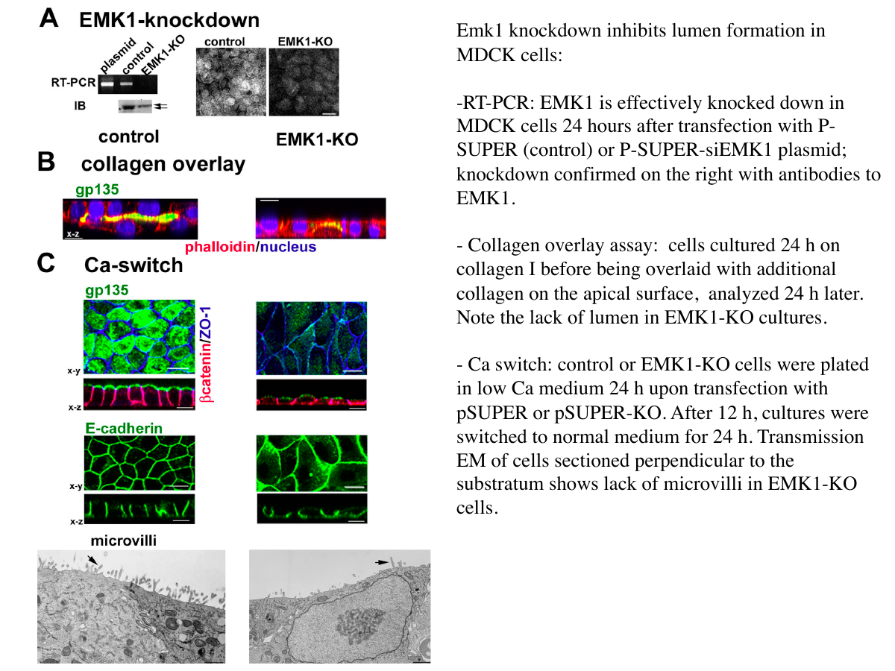
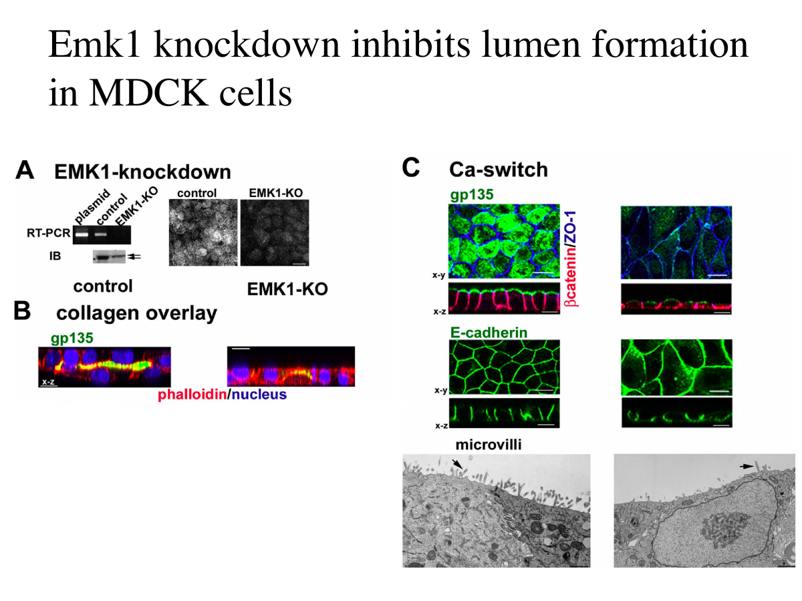
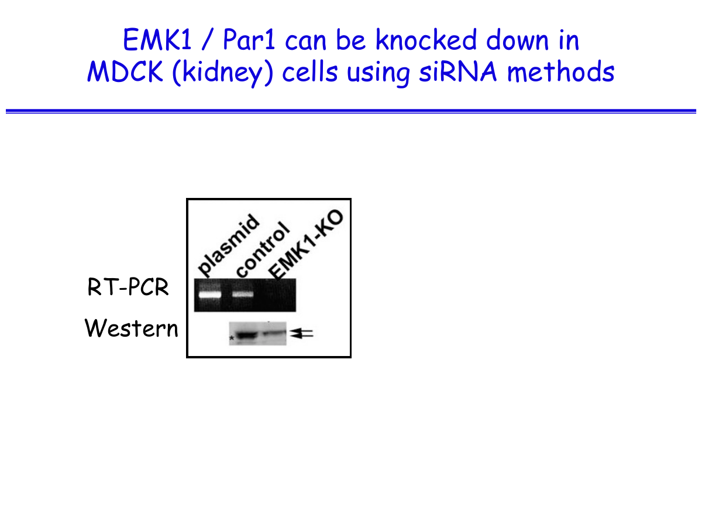
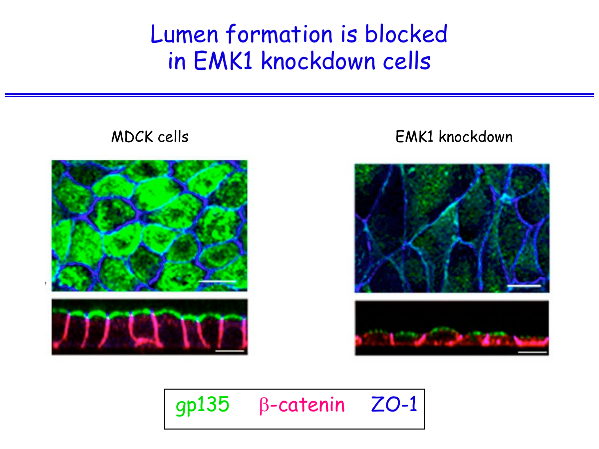
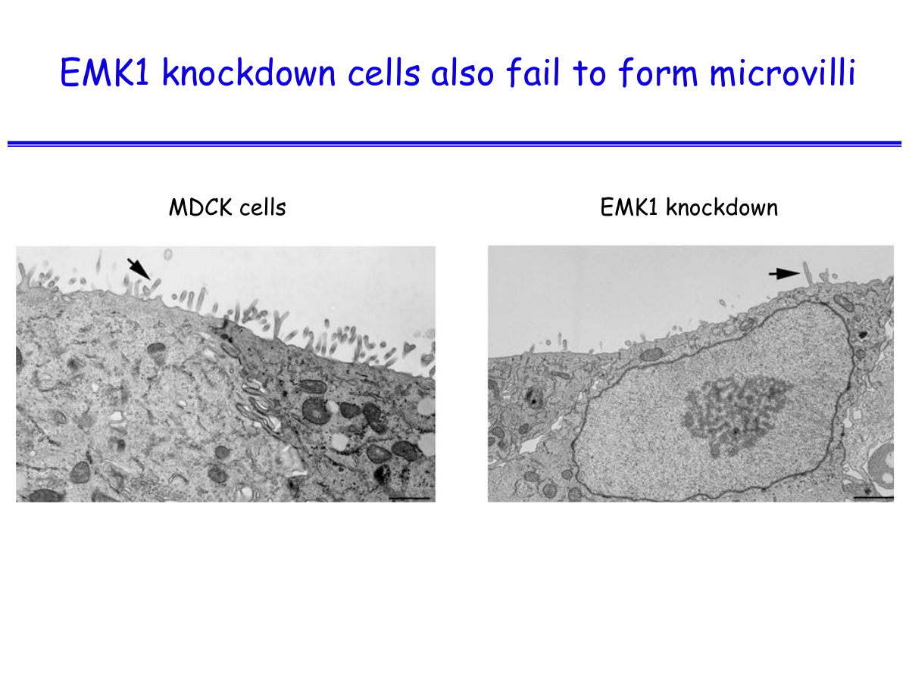
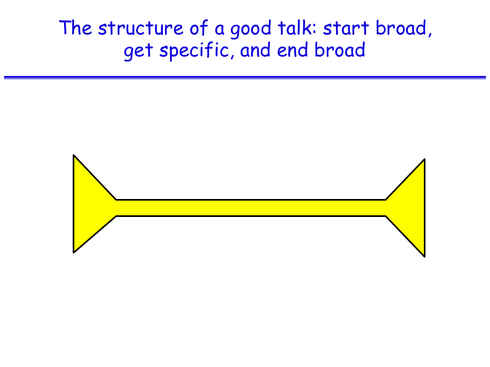
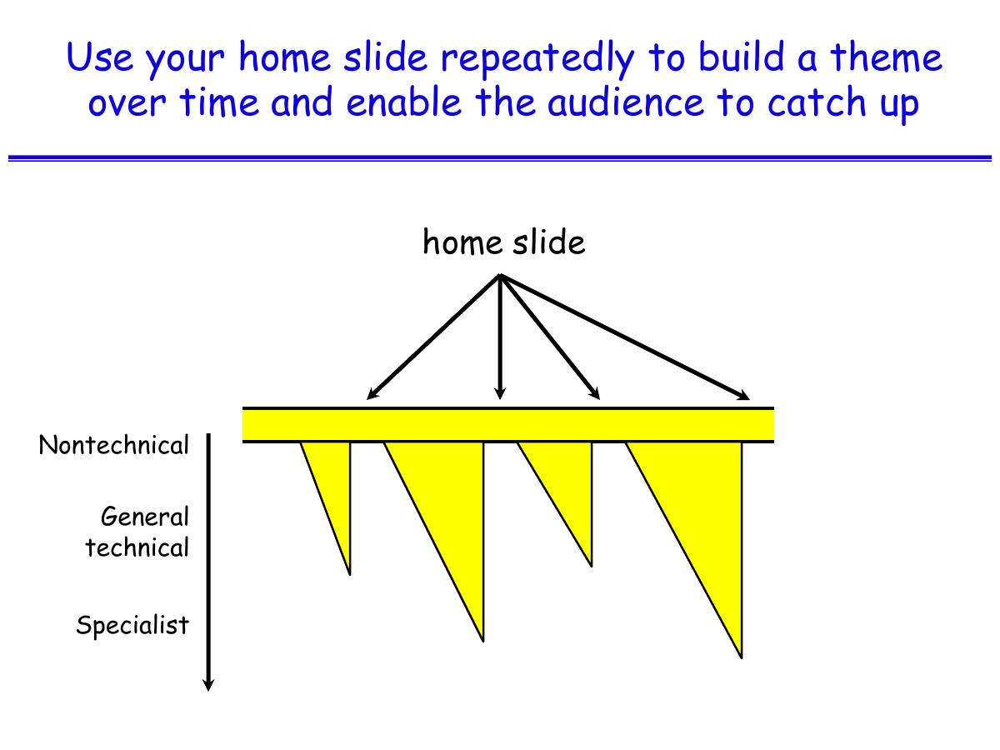

# 原讲义例图与改稿方法

这些 PNG 来自 Susan McConnell 在斯坦福网站公开的配套讲义；保留整页画面，未改动图内数据。页码指 PDF 的一基页码。讲义与视频使用了不同版本的部分案例，因此这些是讲义渲染图，不是视频截图。来源见 [sources.md](sources.md)。

图片仅用于理解设计方法；不把其中实验结果当成用户研究成果，也不把无关生物学图片默认放进用户的报告。

## 1. 删文字之后，整图依然可能太复杂

*原讲义第 7 页。* 这里的“坏例子”是讲者为讨论而制作的展示方式，并非评价原论文科学质量。听众同时面对段落与许多图块，难以知道先看哪里。

*原讲义第 9 页。* 仅删除说明段落，还不能解决图块过多的问题。改稿时先选要支持的结论，再决定哪些 panel 应在当前页面出现，而不是把所有图缩小。

## 2. 保留一条信息，并把阅读所需的标记放在图旁

*原讲义第 51 页。* 学习标题与证据对应，以及把图的性质标清的做法。用于其他领域时，同样可以把术语、单位或组别直接标在相关区域，让读图顺序更明确。

## 3. 围绕一个比较组织页面

*原讲义第 55 页。* 让听众先理解观察方向、组别与颜色，再解释差异。相邻或分步显示应服务于比较，必要的对照与标尺需要保留。

*原讲义第 57 页。* 新结论换一页，让标题与视觉重新配对。原图的每个 panel 不必按照论文排版一次性全部展示。

## 4. 先进入细节，再回到整体

*原讲义第 58 页。* 这是叙事深度的示意，不是强制的页面比例。用它检查：非专业听众是否有入口？结尾有没有说明发现的意义？

*原讲义第 92 页。* 这里展示的是 home slide 的结构用法示意，不是一张可以直接照搬的具体总览图。实际制作时，选与用户研究相关的系统图、核心问题图或模型图作为 home slide，每次回到它时说明进度。

## 一个自行编写的跨领域改稿例子

原稿：标题“实验结果”，下方放全文表格和一段解释。

改稿：如果真实数据支持，标题可写“方案 B 缩短了任务完成时间”；只展示理解这一差异所需的对比，并注明单位、样本与不确定性；讲解先介绍比较条件，再引导观察差异，最后解释结论的适用范围。

这段是整理者编写的应用示例，不是视频或讲义原例，不含虚构测量值。
